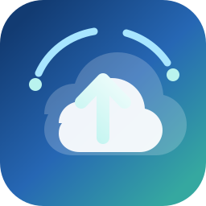

# Release Communications

[](https://learn.microsoft.com/windows/apps/windows-app-sdk/)
[](https://learn.microsoft.com/windows/apps/winui/winui3/)
[](https://dotnet.microsoft.com/)
[](src/ReleaseCommunications.App/Package.appxmanifest)
[](LICENSE)

[English](README-en.md)

Microsoft 365 ロードマップと Azure 更新情報を取得し、公開日の新しい順に閲覧・絞り込み・要約できる WinUI 3 デスクトップ アプリです。UI は日本語（既定）と英語を実行中に切り替えられ、要約言語は UI 言語と独立して選択できます。

> [!NOTE]
> アプリアイコンと通知領域アイコンは、クラウド、更新、リリースの流れを抽象化した本プロジェクト独自の SVG デザインです。Microsoft のロゴ、製品ロゴ、商標は使用していません。

## 主な機能

- Microsoft 365、Azure、または両方の更新情報を取得
- 公開期間、製品、状態、タグ／プラットフォームによる絞り込み
- 公開日時の降順を維持し、日時不明の記事は末尾に配置
- 未選択時は空白、選択後は視覚的な記事詳細を表示するレスポンシブなマスター詳細 UI
- MRC 詳細レコードと信頼できるリンク先 Microsoft ページの本文を使用した全文ベースの要約
- 日本語／英語の UI 設定と、日本語／英語の要約設定を個別に永続化
- 個別要約、表示中記事の並列要約、キャンセル、永続キャッシュ
- 読み込み中、空、部分失敗、失敗、キャンセルの明示的な状態表示
- キーボード、スクリーン リーダー、ハイ コントラスト、ライト／ダーク テーマに配慮した WinUI コントロール
- アプリを表示または終了できる Windows 通知領域アイコン

## ユーザー インターフェイス

<p align="center">
  
</p>

左ペインには公開日の新しい順で更新情報を表示し、選択操作に集中できる構成にしています。右ペインは記事を選択するまで空白のままとし、選択後にグラフィカルなヘッダー、公開情報、全文要約操作、AI 要約、元記事へのリンクを表示します。

## アーキテクチャ

| プロジェクト | 責務 |
|---|---|
| `ReleaseCommunications.Core` | ドメイン モデル、契約、並べ替え／絞り込み、設定検証、要約プロンプトと応答検証 |
| `ReleaseCommunications.Infrastructure` | MRC MCP クライアント、記事本文取得、HTML 抽出、Foundry 接続、JSON 設定／キャッシュ |
| `ReleaseCommunications.App` | WinUI 3 シェル、MVVM、ローカライズ、マスター詳細 UI、通知領域連携 |
| `tests` | 並べ替え、要約、永続化、入力検証、XAML アクセシビリティのテスト |

要約前に必ず対象記事の MRC 詳細を取得します。信頼できる HTTPS URL がある場合のみリンク先本文を取得し、取得できない場合は MRC 詳細を使用して、コンテンツ不足の理由を UI に表示します。

## 必要条件

- Windows 10 バージョン 2004 以降、x64 または ARM64
- .NET 10 SDK と Windows App SDK の開発環境
- WinApp CLI 0.6 以降
- 要約を使用する場合のみ Azure CLI とテキスト対応の Microsoft Foundry モデル デプロイ

## セットアップ

1. Azure CLI で認証します。識別子は実環境の値に置き換えてください。

   ```powershell
   az login --tenant <tenant-id>
   az account set --subscription <subscription-id>
   ```

2. アプリをビルドして起動します。

   ```powershell
   .\BuildAndRun.ps1 .\src\ReleaseCommunications.App\ReleaseCommunications.App.csproj -c Debug --arch x64
   ```

3. **設定**で次を入力し、**接続を確認**、**保存**の順に選択します。
   - Foundry OpenAI v1 エンドポイント: `https://<resource-name>.services.ai.azure.com/openai/v1`
   - テキスト対応モデルのデプロイ名: `<deployment-name>`

4. **更新情報**に戻り、**更新**を選択します。

設定と要約キャッシュは `%LOCALAPPDATA%\ReleaseCommunications` に保存されます。

## セキュリティとプライバシー

- 認証は `AzureCliCredential` のみを使用し、API キー、アクセストークン、CLI 資格情報は保存しません。
- 設定ファイルにはエンドポイント、デプロイ名、表示／要約言語、件数、キャッシュ設定のみを保存します。
- リンク先取得は HTTPS の `microsoft.com` 配下または `aka.ms` に限定し、リダイレクト先も再検証します。
- 自動リダイレクトを無効化し、SSRF、想定外ホスト、過大レスポンスを制限します。
- ダウンロードした HTML と抽出本文はログまたはディスクへ永続化しません。
- 通常のテストは合成データを使用し、外部サービスへ接続せず、モデル料金も発生しません。
- 問題報告には、ユーザー名、ローカル パス、エンドポイント実名、テナント／サブスクリプション ID、資格情報を含めないでください。

公開前には、追跡対象ファイルに対して秘密情報、ローカル パス、個人用リソース名を検索してください。本リポジトリのサンプル値はすべてプレースホルダーです。

## ビルドとテスト

```powershell
dotnet restore .\ReleaseCommunications.slnx
dotnet test .\ReleaseCommunications.slnx -c Release --no-restore
dotnet restore .\src\ReleaseCommunications.App\ReleaseCommunications.App.csproj -r win-x64
dotnet build .\src\ReleaseCommunications.App\ReleaseCommunications.App.csproj -c Release -p:Platform=x64 --no-restore
```

UI の起動診断には、アナライザーを組み込んだ `BuildAndRun.ps1` を使用してください。MSIX パッケージの実行ファイルを直接起動しないでください。

## ライセンス

[MIT License](LICENSE) — Copyright (c) 2026 tokawa-ms
